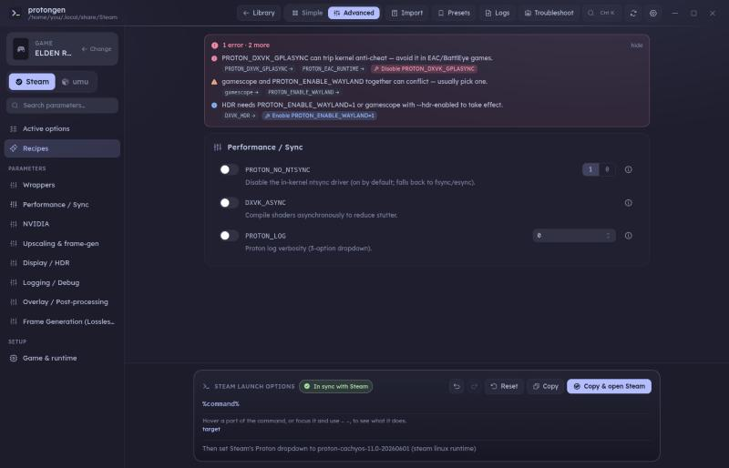
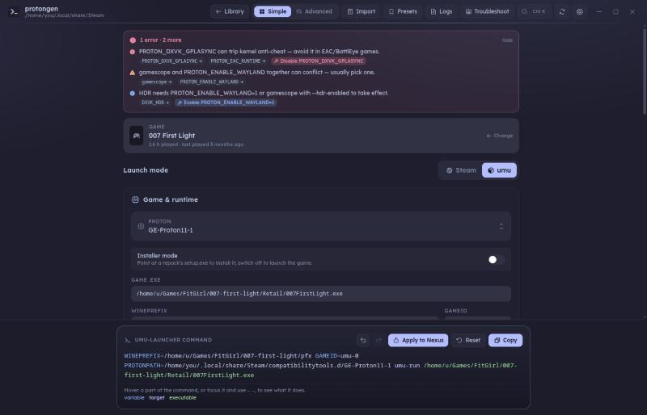
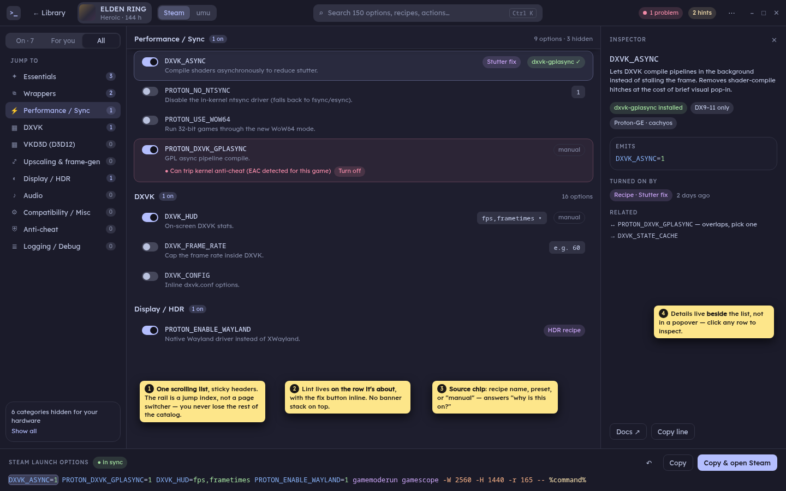
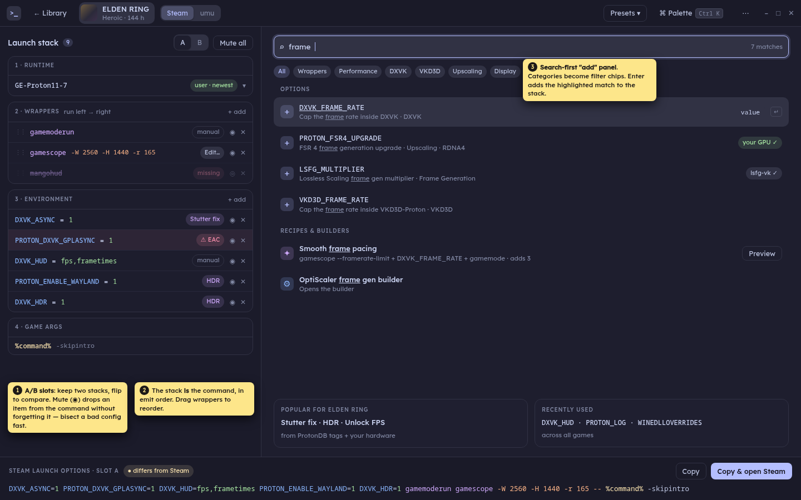
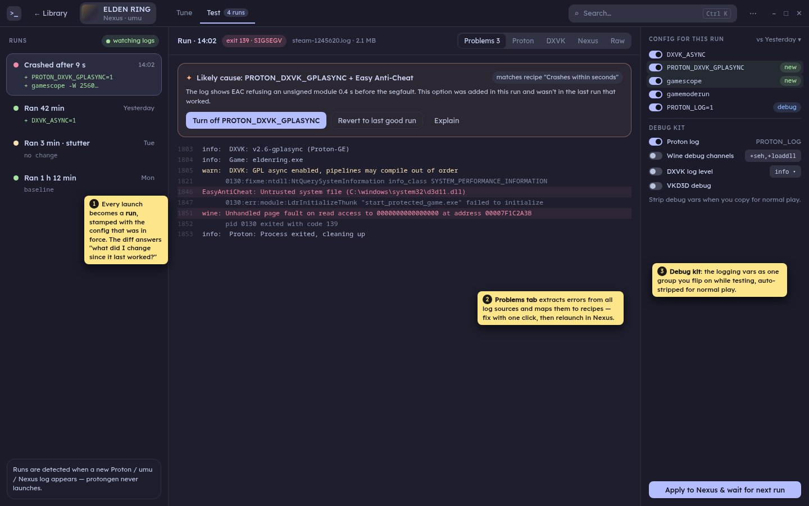
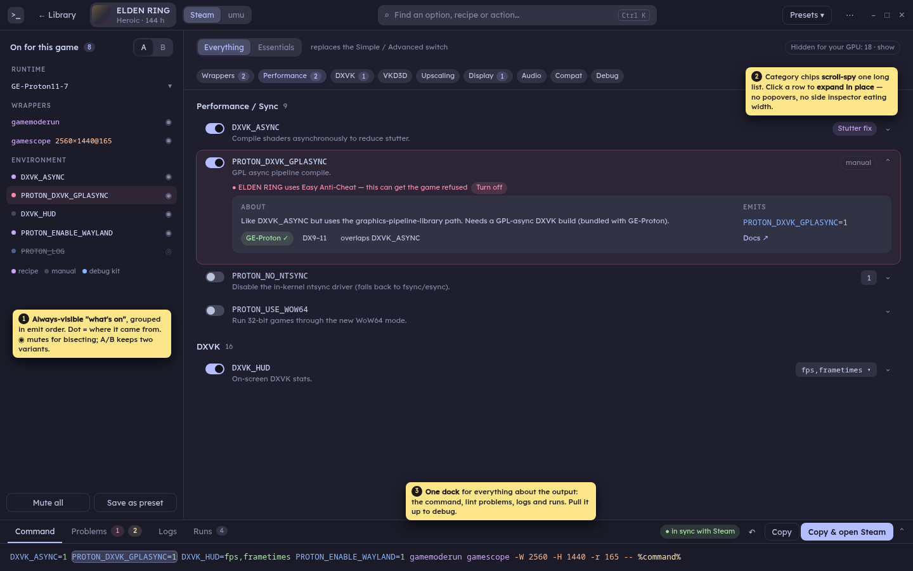
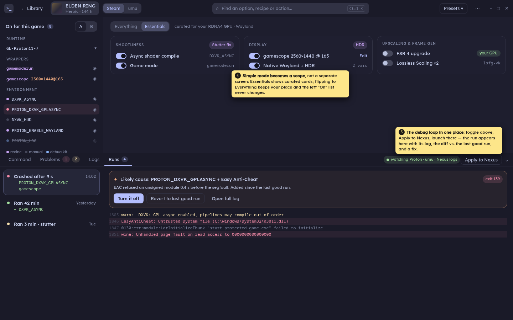

# Builder redesign — exploration

Status: **rollout steps 1–3 built** (layout pass + OptiScaler builder rework, On column +
Essentials scope; see below). Mockups are static HTML in [`mockups/`](mockups/)
(Catppuccin Mocha tokens + Lexend from `app.css`), rendered to [`img/`](img/) at 1440×900.
Yellow sticky notes are annotations, not UI.

## What we're fixing

From the review of today's Advanced mode:

1. **Finding a toggle.** 15 categories, one panel at a time. You have to know that
   `DXVK_ASYNC` lives in *Performance / Sync* and not *DXVK*.
2. **Seeing what's on.** "Active options" is just one more rail entry. Nothing on screen
   answers "what's on for this game, and why?" while you're browsing a category.
3. **Too many top buttons.** Library · Simple · Advanced · Import · Presets · Logs ·
   Troubleshoot · palette · refresh · settings: ten controls, and two of them (Logs,
   Troubleshoot) are the debugging tools, hidden in dialogs.
4. **Debug loop** (toggle → launch in Nexus/Steam → read logs) crosses three dialogs and
   the command bar. Nothing connects "this run crashed" to "this is what I changed".

| Today: Advanced | Today: Simple |
| --- | --- |
|  |  |

The lint stack sits above every section and pushes content down. The rail switches
pages, so a category shows three rows and leaves the rest of the screen empty. The game
and the Steam/umu switch are squeezed into the rail.

---

## Direction A — One catalog + inspector

- One long list with **sticky category headers**. The rail becomes a *jump index* with
  on-counts, plus an **On / For you / All** filter.
- **Lint moves onto the row** it's about, with the fix inline. The top bar keeps only a
  `1 problem · 2 hints` chip that scrolls to them.
- **Source chip** on each row: recipe name, preset, or `manual` (`appliedBy` already
  exists and today is only half-shown).
- **Inspector** on the right: docs, what the row emits, what turned it on, and related or
  conflicting vars.
- Top bar drops to: back, game, Steam/umu, one search, health, `⋯`.

**+** Smallest change from today; fixes *finding*. **−** The inspector costs 340 px. It
still doesn't do much for *what's on* or debugging.

## Direction B — Launch stack

- The left half **is the command**: Runtime → Wrappers (drag to reorder) → Environment →
  Game args, in emit order. Everything that's on, and nothing that's off.
- **Mute (◉)** drops an item from the command but keeps it in the stack, so you can bisect.
  **A/B slots** hold two variants of the stack to flip between.
- The right half is a **search-first "add" panel**. Categories become filter chips, and
  recipes and builders show up in the same results.

**+** Best answer to *what's on*. Debugging by bisection is natural. **−** You can't browse:
a newcomer who doesn't know var names has to search. It's a big mental-model shift.

## Direction C — Tune / Test

- A **Test** tab next to Tune. Each launch becomes a **run**, stamped with the config in
  force and a **diff vs. the previous run**.
- The **Problems** view pulls errors out of all log sources (`logs.rs`) and matches them to
  troubleshooter recipes: *Likely cause → Turn it off / Revert to last good run*.
- **Debug kit**: the logging vars as one group you turn on while testing, stripped
  automatically when you copy for normal play.
- protongen still **never launches**. Runs are inferred when a new Proton/umu/Nexus log
  shows up (`watch.rs` already polls mtimes).

**+** Turns the debug loop into a first-class flow. **−** It's a mode, not a layout: it
doesn't fix Tune itself.

---

## Recommended — D: Workbench (A + B + C)

One screen. The useful part of each direction, with no modal switching.

| Zone | From | What it does |
| --- | --- | --- |
| **Top bar** | A | Back · game · Steam/umu · search (= palette) · Presets · `⋯`. |
| **Left: "On for this game"** | B | Always-visible stack in emit order. A dot shows the source (recipe / manual / debug kit), ◉ mutes, A/B slots. Click an item to scroll the catalog to it. |
| **Centre: catalog** | A | **Everything / Essentials** scope (replaces the Simple/Advanced switch). Category chips scroll-spy one list. Rows **expand in place** for details; lint sits inline. |
| **Bottom dock** | C | Tabs: **Command · Problems · Logs · Runs**. Collapsed, it's today's command bar. Pull it up and it's the debugger, with the cause diagnosis, revert to last good run, and Apply to Nexus. |

Where today's ten header controls go:

| Today | In D |
| --- | --- |
| Library | `← Library` (unchanged) |
| Simple / Advanced | **Essentials / Everything** scope in the catalog header |
| Import | `⋯` menu and palette ("Import command…") |
| Presets | stays a top-bar menu (frequent) |
| Logs | dock → **Logs** tab |
| Troubleshoot | dock → **Problems** tab (recipes matched to log errors), plus the palette |
| Palette | *is* the search box |
| Refresh, Settings | `⋯` menu |
| Lint banner stack | inline on rows, plus the **Problems** count in the dock |

### Feasibility notes (against the invariants in CLAUDE.md)

- **Read-only / Nexus launches** are untouched. Runs are detected passively from logs, and
  "Apply to Nexus" is the existing `nexus::set_launch`.
- **Mute** and **A/B slots** are new `Store` fields, so they need the six-layer rule
  (`store.rs` → `types.ts` → `state.svelte.ts` → `mock.ts` → UI, with a partial-table test).
  Muted items must round-trip through `save_store` (#43).
- **Runs** need a small new backend piece: snapshot the `Config` hash when the command is
  applied or copied, then pair it with the next log `logs.rs` sees for that game. Store
  the last N runs per game.
- **Problems** reuses `lint.rs` and the troubleshooter recipes. Matching log lines to
  recipes needs a `log_patterns = [...]` key in `recipes.toml`, which keeps it data-driven.
- **Inline row expansion** replaces `InfoPopover`, which also removes one bits-ui popover
  layer (fewer #63-style risks).
- The **dock** is a resizable pane, not a `Dialog`, so it needs no `restoreScrollDelay`.

### Suggested rollout

1. ✅ **Layout pass:** top-bar consolidation, single scrolling catalog with sticky headers and
   chips, inline lint, in-place expansion. No store changes. Fixes *finding* and the
   *top-button* clutter. Built with a tab row (Parameters · On · Recipes · Game & runtime)
   in place of the rail, until step 2 brings the "On" column. Also reworked the
   **OptiScaler builder**: one-line install status (the fetch flow unfolds from it), settings
   grouped Upscaler → Frame gen → Image → *Fix a problem* (folded) → Loading, app-standard
   switches, and a sticky side summary listing exactly what Apply writes plus "not applied".
2. ✅ **"On" column and Essentials scope:** left stack; Simple/Advanced becomes a scope.
   Built keeping `ui_mode` as the stored value ("simple" = Essentials), so no migration.
   Essentials reuses SimplePanel's cards (open question 2). The column docks from 1100 px
   and is an overlay with an "On" toggle below that (open question 1). It replaces the
   Active options page and its tab; the column's dots show source (recipe / manual) and
   take the colour of a lint notice about that item. Mute and A/B wait for step 4.
3. ✅ **Dock:** Command / Problems / Logs tabs (moves the LogViewer and Troubleshooter in).
   Problems = lint on the command + the fix recipes (searchable by symptom) + the AI
   troubleshooter when enabled. Matching log lines to recipes (`log_patterns`) is left
   for step 5, with Runs. The lint banner is gone from both scopes; the Everything
   toolbar's lint chip opens Problems.
4. **Mute + A/B:** store fields.
5. **Runs:** backend run tracking plus diff and "revert to last good".

## Open questions

1. **Width:** D needs about 1100 px for three zones. Should the left "On" column collapse
   into a top strip below that, or become a toggle?
2. **Essentials content:** keep SimplePanel's current cards, or build Essentials as a
   `params.toml` tag (`essential = true`) so it stays data-driven?
3. **Runs for Steam games:** Steam games only log with `PROTON_LOG=1`. Should the debug kit
   turn that on by default while the Runs tab is open?
4. **A/B:** is two slots enough, or should these just be per-game presets?
5. **Library:** out of scope here. Should it get the same pass (fewer banners, a dock)?
